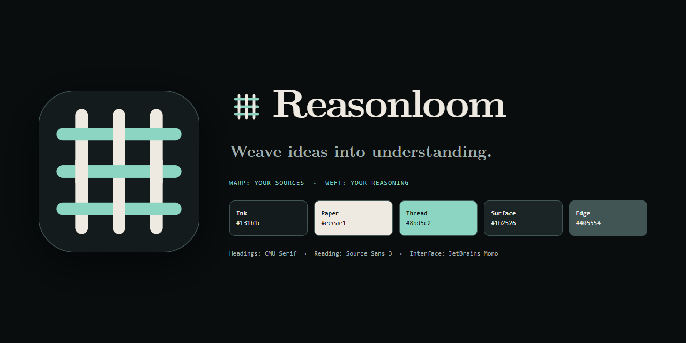
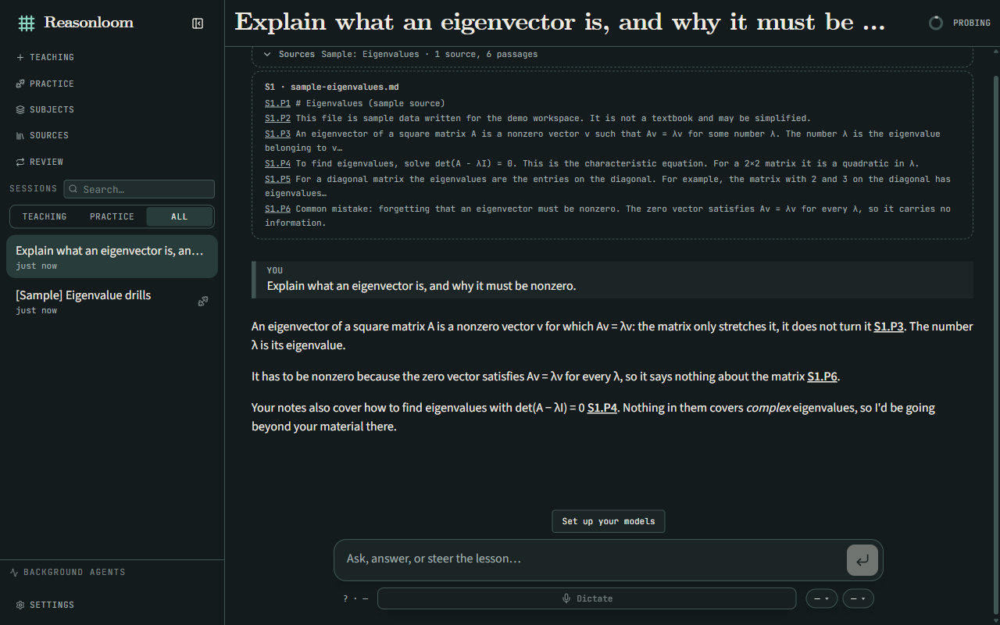
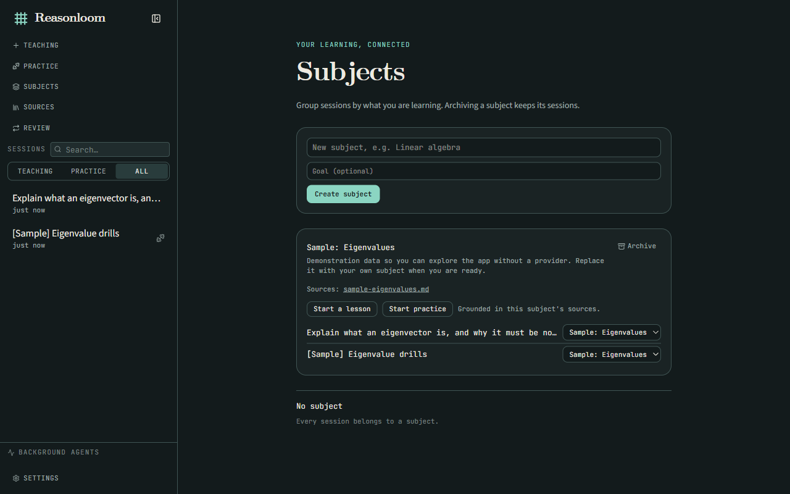
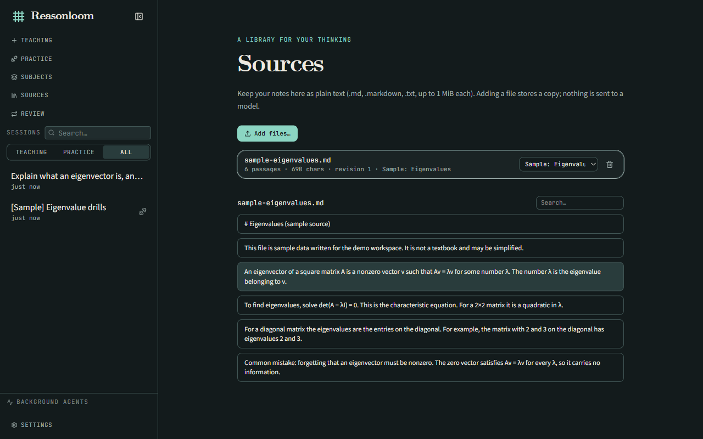
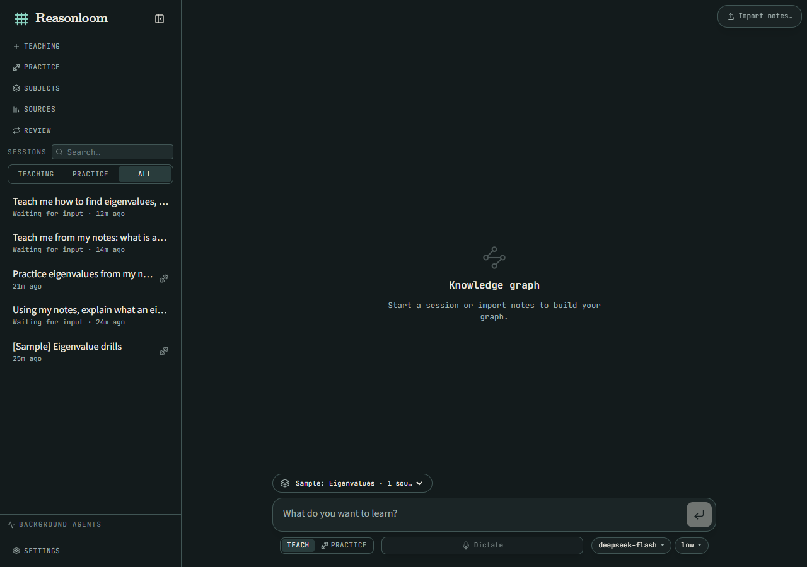
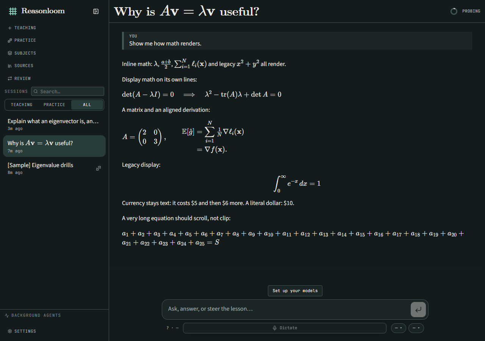
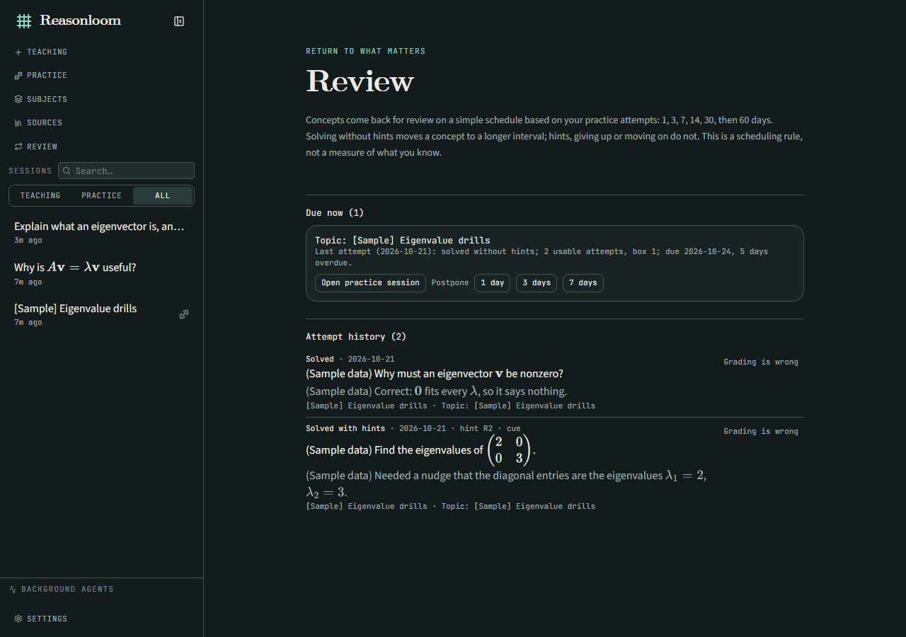

<p align="center">
  
</p>

<h1 align="center">Reasonloom</h1>

<p align="center"><strong>Weave ideas into understanding.</strong></p>



I'm an AI student, and I kept running into the same problem when studying: my notes were in one place, my AI conversations in another, and the things I needed to practise were easy to forget. I found [LearnHarness](https://github.com/amosblomqvist/learnharness) by Amos Blomqvist and liked how it teaches step by step and checks your understanding. **Reasonloom** is my fork, built around the way I wanted to use it for my own studies.

The teaching engine, knowledge graph, practice sessions, dictation, model integrations and desktop foundation come from LearnHarness. My work adds the subjects, source library, source-grounded sessions, review flow and visual identity described below. The original project is licensed under AGPL-3.0; this fork isn't endorsed by its author.

## What I added

- **Subjects** keep lessons and practice together for a topic I'm studying.
- **Sources** let me bring my Markdown and text notes into a local library.
- **Source-grounded sessions** pass the selected subject's notes to the model and link citations back to the passages it saw. The citations still need checking; they're not proof that an answer is correct.
- **Review** brings practice attempts back on a simple schedule and shows why they're due.
- **The Reasonloom identity** gives the fork its own name, icon, colours and typography.

Before and after:

| LearnHarness (before) | Reasonloom (now) |
| :---: | :---: |
|  |  |

*The reply in the "after" screenshot is a scripted example I used for the picture, not live model output.*

## Get it running

You need Node.js (I built and tested it on Node 24).

```bash
git clone https://github.com/osamaPY/learnharness-fork.git
cd learnharness-fork
npm install
npm run dev
```

Open http://localhost:3000. There's no installer yet, so for now it runs from source.

## How to use it

### 1. Connect a model
Open **Settings** (bottom of the sidebar), add an API key for the provider you like, and pick a model for each of the three slots. You pay your provider directly; there's no Reasonloom account or markup. Chats, notes, graph and keys all stay on your machine.

No key yet? Skip to step 2 and load the sample workspace to look around.

### 2. Make a subject
Click **Subjects** in the sidebar, give it a name and (optionally) a goal like "understand eigenvectors well enough to do the homework". Each subject card has **Start a lesson** and **Start practice** buttons, and you can move any session into a subject with the dropdown next to it. Archiving a subject hides it but keeps its sessions.

On an empty Subjects page there's a **Load the sample workspace** link. It creates a clearly labelled fake subject, source and practice record so you can click around without an API key.



### 3. Add your sources
Open **Sources** and click **Add files** to add `.md`, `.markdown` or `.txt` notes (up to 1 MiB each). Then:

- Use the dropdown on a source to attach it to a subject.
- Click a source to read it split into passages, and use the search box to find things.
- Hover a passage and click **Link** to copy a link straight to it.
- Add the same file again and it's skipped as a duplicate. Add an edited version with the same name and it updates in place.

Adding a source only stores a copy locally. Nothing is sent to a model until you start a session with that subject.



### 4. Learn or practice from your sources
Start a session in either of these ways:

- Press **Start a lesson** or **Start practice** on a subject card, or
- Use the **subject picker** above the box on the home screen (it only shows up once you have a subject), then type what you want to learn.

The model is handed that subject's passages, told to prefer them, to say so when your notes don't cover something, and to cite what it used. A collapsible **Sources** card at the top of the session shows exactly what it was given. When the reply cites something like `S1.P3`, click it and you land on that passage in your notes.

*Teach* mode explains and checks your understanding. *Practice* mode gives you problems to solve.



### Math looks like math
Anywhere a formula shows up, it's typeset with LaTeX (KaTeX): in the model's replies, session titles in the sidebar, your source passages, the "Sources" card, and Review. Write `$x^2$` for inline and `$$...$$` on its own line for a displayed equation (`\(...\)` and `\[...\]` work too). Prices like "$5 and $6" are left as text, and a bad formula shows its source instead of breaking the page.



### 5. Come back for review
Finished practice problems show up on **Review**. Each concept returns after 1, 3, 7, 14, 30, then 60 days, and the page tells you why it's due ("last attempt solved with hints, 5 days overdue"). Use **Postpone** for 1, 3 or 7 days, or **Grading is wrong** if the model marked you incorrectly (that attempt then stops counting).



## What's still rough

I'd rather you know than be surprised:

- No installer or release yet. Run it from source.
- Source grounding is an instruction to the model, not a fence. A citation shows the passage exists, not that it supports the claim. I haven't tested it with a live model yet.
- The review schedule is a simple fixed rule, not proof it helps you remember. Days are UTC.
- Sources are text and Markdown only for now: no PDF, web pages or OCR. The model only gets about 24k characters from up to 10 sources, and the Sources card tells you what was left out.
- Only sessions started with a subject chosen are grounded; existing sessions aren't.
- The macOS icon and installer art are still LearnHarness's, and I haven't checked whether the name "Reasonloom" is free to use.

## More

[Build progress and test results](docs/BUILD_PROGRESS.md) · [Decisions](docs/BUILD_DECISIONS.md) · [Roadmap](docs/FORK_ROADMAP.md) · [Development](docs/development.md) · [Architecture](docs/architecture.md) · [Issues](https://github.com/osamaPY/learnharness-fork/issues)

## License

[AGPL-3.0](LICENSE). The original copyright and notices are kept. If you run a modified version for other people over a network, you have to offer them the source.
