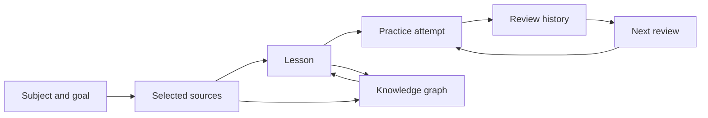

# LearnHarness fork: product roadmap and idea backlog

Prepared: 29 October 2026

**Status:** Planning document. The owner welcomed the initial ideas and requested that they be collected and expanded here. This does not settle the product name, detailed designs, data contracts, default behavior, or the scope of every release. Follow `AGENTS.md`: investigate, resolve open decisions with the owner, get the implementation plan approved, and then build.

**Primary objective:** Create a substantially improved public GitHub project whose original contributions are easy to understand, experience, and verify. Preserve credit to LearnHarness and its author, Amos Blomqvist. Demonstrate the work through functioning features, thoughtful design, meaningful tests, and clear releases.

**Recommended product direction:** A personal learning workspace connecting study materials, teaching, practice, and long-term review.

**Recommended flagship features:** Subject workspaces, a source library with inspectable references, and a persistent review system. Support these with a cohesive interface and an accessible demonstration.

This document is a menu with a recommended sequence. It is not a commitment to build every idea before releasing anything.

## 1. The short version

- Put the project on the owner's GitHub as a credited fork.
- Preserve existing local work and assess newer upstream changes before choosing a baseline.
- Give subjects, goals, sources, sessions, and reviews a coherent home.
- Make lessons and practice traceable to selected study material.
- Add review history and scheduling that explain why something needs practice.
- Refine the dashboard, classroom, graph exploration, onboarding, and recovery flows.
- Make the result easy to try through sample data, a short walkthrough, and reliable releases.
- Expand later into exam preparation, teach-back exercises, a misconception journal, and richer imports when the core experience works well.
- Prototype distinctive learning experiences: prediction experiments, reasoning repair, practical missions, error-hunting exercises, cross-subject connections, and evidence-backed learning portfolios.

### Consolidated scope: one list of proposed changes

Updated after the owner's request for more ambitious ideas. This is the complete grouped scope, including earlier ideas; details and acceptance checks appear below. **Core** means recommended for the main product journey, **Expansion** means a later selectable increment, and **Experimental** means a bounded prototype must demonstrate value before production commitment. These labels are recommendations, not approved implementation defaults.

| ID | Proposed change | Scope / status |
| --- | --- | --- |
| C01 | Independent GitHub fork and product identity; upstream integration; separate installers, data directory, updates, and releases | Core foundation |
| C02 | Cohesive visual redesign, onboarding, sample workspace, dashboard, and clear resume/review actions | Core |
| C03 | Subject workspaces, goals, milestones, session organization, improved titles, archive, and editable learning paths | Core; advanced paths are Expansion |
| C04 | Source library with import progress, previews, passage/page references, highlights, versions, and duplicate handling | Core; text-PDF support is a bounded increment |
| C05 | Broader imports: URLs, Markdown folders, scanned documents/OCR, images, and timestamped transcripts | Expansion, format by format |
| C06 | Source-grounded lessons and practice restricted to selected material, with clear handling of missing evidence | Core |
| C07 | Refined classroom: optional source/plan panels, long-question handling, focus mode, pacing controls, recaps, saved drafts, and optional lesson detours | Core; branching detours are Expansion |
| C08 | Persistent attempt evidence, explained review scheduling, progress history, confidence context, grading corrections, and optional reminders/weekly recaps | Core; reminders and deeper analytics are Expansion |
| C09 | Better graph exploration: subject/source filters, search, accessible list view, evidence inspector, prerequisite paths, history, and optional review overlays | Core inspection; advanced history/correction tools are Expansion |
| C10 | Unified search, bookmarks, question notebook, and a shelf of reusable diagrams and interactive demos | Core navigation; artifact shelf is Expansion |
| C11 | Exam preparation, mock exams, error analysis, teach-back exercises, misconception journal, and varied transfer practice | Expansion |
| C12 | Study summaries, portable subject exports, study packs, and possible flashcard exports | Core portability; richer formats are Expansion |
| C13 | Improved dictation, optional transcription adapters, cross-language learning, and offline access to stored material | Core dictation reliability; new capabilities are Expansion |
| C14 | Recovery, backups/restore, migrations, data privacy, and sanitized diagnostics | Core |
| C15 | Provider diagnostics, transparent model presets, cost reporting, and optional spending warnings/controls | Core transparency; advanced controls are Expansion |
| C16 | Accessibility, responsive layouts, measured performance, meaningful tests, AI behavior evaluation, and release verification | Core quality |
| C17 | Portfolio presentation: README, screenshots, walkthrough, sample dataset, no-provider demo, architecture notes, and contribution comparison | Core release |
| X01 | Prediction laboratory: predict, experiment, observe, and explain | Experimental; first prototype candidate |
| X02 | Reasoning debugger: inspect and repair an explicit chain of reasoning | Experimental |
| X03 | Practical missions: learn toward a concrete artifact with checkpoints and a rubric | Experimental; second prototype candidate |
| X04 | Error-hunting challenges: find and repair a deliberately flawed explanation | Experimental |
| X05 | Cross-subject connections: inspect useful structural analogies and where they fail | Experimental |
| X06 | Learning evidence portfolio: assemble inspectable examples of what the learner can do | Experimental |

**Suggested order:** Establish C01-C08 and the necessary C14-C17 foundations; then finish the integrated flow and select expansions. Prototype X01 and X03 first after their dependencies exist. Do not open six experimental implementation tracks simultaneously.

The owner has authorized planning and expanding this document. No application feature is marked implemented or fully designed by being included in this table.

## 2. What exists already

The upstream project is a substantial foundation. The fork's README must distinguish inherited capabilities from new contributions.

| Existing capability | How the fork could extend it |
| --- | --- |
| Adaptive probing and teaching | Goal-oriented journeys across multiple sessions, clearer pacing controls, and explicit recaps |
| Separate practice sessions | Persistent attempt history, material scope controls, scheduling, and review explanations |
| Knowledge graph and reasoning chains | Subject filtering, readable evidence panels, prerequisite exploration, and optional review overlays |
| Notes import | An organized library, document previews, source versions, and richer supported formats |
| Research, visual, and demo agents | Better source presentation, reusable artifacts, reliability evaluation, and user controls |
| Dictation | Better recovery and optional additional transcription adapters after compatibility research |
| Provider/model configuration and usage reporting | Connection diagnostics, understandable presets, and optional spending controls |
| Markdown session export | Curated study packs and portable subject exports |
| Electron packaging and updates | Fork-specific identity, update channels, and release ownership |
| Automated tests and CI | Meaningful coverage for new flows, visual checks, migration tests, and AI behavior evaluation |

### Investigation snapshot

- Local HEAD inspected: `3dd5211`, package version `0.3.9`.
- Upstream revision inspected: `dc4c398d5167865b84b0ccb3ec809eb88bf8f65f`, preparing `0.4.0`; the comparison reported 60 commits ahead of the local HEAD.
- That upstream work includes custom/local provider support, Claude Code integration, file-path attachments, and runtime/UI fixes. Recheck before implementing overlapping features.
- Existing uncommitted changes were present in `app/api/stt/token/route.ts`, `components/dictation.tsx`, `electron/main.cjs`, and `package-lock.json`.
- Existing untracked Windows launch helpers were present: `run-desktop.vbs`, `scripts/run-desktop.ps1`, `start-desktop.bat`, `start-server-silently.vbs`, and `start-web.bat`.
- The current alternative home displays knowledge/session counts. A richer daily dashboard would materially change the experience.
- The graph contract explicitly excludes quiz outcomes and understanding assessments. A learner progress model should be a separate concept, not a reinterpretation of graph facts.
- The notes-import route reads uploaded files as text and already has bounded concurrency and structured outcomes. A source library should extend this work rather than claim import/retry handling does not exist.
- Some architecture and planning documents describe historical implementations. Verify each assumption against the selected code baseline.

These are code/documentation observations and public issue reports. No live usability study, full test run, or reproduction of reported bugs was performed for this roadmap.

## 3. GitHub ownership and maintenance

### Recommended approach: fork and selectively contribute

A fork is a repository on the owner's GitHub with its own branches, releases, and changes, while retaining a visible connection to the original. A pull request is a proposal to incorporate a change into another repository. These approaches can coexist.

Recommended setup, after the repository destination and baseline are approved:

1. Inventory and preserve tracked modifications and untracked launch helpers. Do not discard them during synchronization.
2. Choose the GitHub account, repository name, and product identity with the owner.
3. Create the fork and use its repository as `origin`; retain the original as `upstream`.
4. Select a current upstream base, review overlapping changes, and carry forward the useful local work.
5. Establish baseline build, typecheck, lint, and test results before large changes.
6. Keep feature commits scoped and document important product/architecture decisions.
7. Offer focused, reproduced fixes upstream when appropriate. Larger product-direction changes can remain in the fork.
8. Reassess upstream periodically through deliberate integration changes, with migration and regression checks.

Do not rewrite inherited history to imply original authorship. A clear explanation of substantial improvements makes the contribution easier to evaluate.

### License and attribution

The inspected package specifies `AGPL-3.0-only`. Preserve the license and applicable notices, clearly identify modifications, and fulfill corresponding-source obligations when distributing the modified application. Modified versions used over a network also have source-availability requirements. Keep release source and executable artifacts aligned.

References: [GitHub forks](https://docs.github.com/en/pull-requests/reference/forks), [repository license](../LICENSE), [GNU AGPL](https://www.gnu.org/licenses/agpl-3.0.html).

### Desktop identity is part of forking

Review the product name, application ID, data directory, icons, package metadata, installer names, release destinations, and updater configuration. The fork should be able to coexist with the original application and receive the fork's updates.

The existing release configuration points to the upstream repository; a workflow also dispatches to the original website repository. Replace or disable inherited deployment integrations as appropriate to the approved release plan. Upstream signing credentials are not available merely because the code is forked.

## 4. The experience to build toward

Example: A learner wants to understand linear algebra for machine learning.

1. Create a subject and describe a concrete goal.
2. Add notes or a textbook chapter and inspect what was imported.
3. Start a lesson using selected sources and prerequisites.
4. Open a reference to see the passage behind an explanation.
5. Solve a practice problem within the selected scope.
6. Inspect the feedback and record of that attempt.
7. Return later to an explained review recommendation.
8. Export a useful summary or study pack.

The knowledge graph describes concepts and reasoning. Review history describes learner evidence. They can reference each other without becoming the same store.

## 5. Flagship A: subject workspaces and a useful home

**Problem:** Sessions and graph knowledge need a more explicit structure for sustained learning across subjects.

### Proposed first scope

- Subject overview containing a goal, related sources, recent lessons, and practice activity.
- A home dashboard with a clear resume action, review entry point, and subject navigation.
- Session organization with search, filtering, renaming, and an archive workflow.
- A clear route from a subject into teaching or practice.
- A visible distinction between a subject's long-term goal and an individual lesson's plan.
- Helpful empty states that lead to an action or sample workspace.

### Further ideas

- Goal milestones: observable capabilities such as explaining an idea or solving a type of problem.
- A user-editable learning path assembled from prerequisite relationships.
- Optional study-session duration preferences and a graceful stopping point.
- Subject templates for conceptual study, technical interviews, language practice, or exam preparation.
- A weekly recap showing actual activity and evidence, without inventing mastery percentages.
- A subject overview showing unfinished lessons and unresolved questions.

**Acceptance example:** Create a subject, attach material, begin a lesson, restart the application, and resume with the same subject association and context.

**Decisions to settle:** Terminology; one global graph with subject membership versus separate graphs; whether sessions may belong to multiple subjects; archive/deletion rules; treatment of existing ungrouped sessions; goal editing and progress meaning.

## 6. Flagship B: source library and source-grounded study

**Problem:** Importing material should produce something the learner can browse, understand, and cite throughout learning.

### Proposed first scope

- Library list with source title, type, import state, and subject association.
- Markdown/text support first, with text-based PDFs as a separately validated increment.
- Inspectable extracted text before or after ingestion, depending on the approved flow.
- Progress by meaningful processing stage; actionable partial-failure information and retry.
- Source links from lessons and questions to stable passages or PDF pages.
- A scope choice between selected-material practice and broader exploration.
- Visible handling when a source cannot support a requested answer.
- Clear treatment of re-imported, changed, renamed, and duplicate files.

### Further ideas

- Highlights that can become bookmarks, questions, or lesson starting points.
- Source outline navigation and side-by-side reading while learning.
- Version history with a warning when a lesson cites an older source revision.
- Compare two explanations and identify agreement, assumptions, and disagreement.
- URL imports with visible capture date and supported-content limits.
- Obsidian-style Markdown folder import, respecting relative links and attachments where supported.
- OCR for scanned PDFs/images after text-based imports are reliable.
- Transcript imports with timestamps; direct video ingestion only after separate feasibility work.
- Source collections that can be shared without automatically sharing private conversations.

**Acceptance example:** Import a sample chapter, generate a source-linked question, and open the exact reference from its explanation. A failed import can be retried without duplicating successfully stored material.

**Engineering considerations:** File validation, bounded size/page limits, extraction quality, stable source identities, passage anchors, deletion semantics, and versioned references. Imported text is evidence, not authority to change application instructions or execute actions.

**Decisions to settle:** Formats and limits; whether originals are copied into app-managed storage; folder versus upload behavior; source-retention rules; citation presentation; how strictly material scope is enforced; and whether OCR may call an external service.

## 7. Flagship C: review history and long-term practice

**Problem:** Practice sessions do not yet form a dedicated, inspectable system for deciding what to revisit over time.

### Proposed first scope

- Persistent attempt evidence linked to the concept or reasoning chain being exercised.
- Review queue with the reason each item was selected.
- Review scheduling with clearly defined reschedule, skip, and completion behavior.
- History showing prior attempts and feedback.
- Separate recording of observed performance, learner confidence, and model assessment where applicable.
- A way to flag incorrect or unhelpful grading.
- Clear handling of insufficient evidence and unassessed concepts.

Example explanation: “You needed a hint in your last attempt; this review uses a different problem.” This is useful only when the underlying attempt actually records that event.

### Further ideas

- A misconception journal linking recurring mistakes to examples and corrective lessons.
- Teach-back exercises in which the learner explains a concept, with typed or dictated responses.
- Delayed checks that distinguish immediate familiarity from later recall.
- Transfer problems that apply an idea in a different setting.
- Mixed-topic practice and prerequisite-focused remediation.
- Optional confidence-versus-performance views with sufficient sample context.
- User-authored questions alongside generated questions.
- Later export to flashcard tools where content maps cleanly to that format.

**Acceptance example:** Complete an attempt, close and reopen the app, see its evidence and next-review decision, and reschedule it without rewriting the original attempt.

**Engineering considerations:** Keep review records separate from graph propositions. Link to stable concept and source identities. Define events before choosing a scheduling algorithm. Keep scheduling deterministic and clock-testable. Distinguish attempts completed with hints from unsupported success claims. Store enough provenance to explain derived state.

**Evaluation boundary:** A scheduler working correctly does not establish that the application improves retention. Learning-effectiveness claims require a suitable evaluation.

**Decisions to settle:** Scheduling policy; attempt fields; grading rubric; handling ambiguous answers; confidence collection; manual corrections; concept merge/deletion effects; timezone/day boundaries; and whether reminders exist at all.

## 8. Classroom, graph, and interface improvements

### Classroom experience

- Explore a lesson layout with optional plan and source panels.
- Keep long questions usable without unpredictable collapse or inaccessible submit controls.
- Make teaching, answering, and feedback states visually understandable.
- Allow bookmarks on explanations, diagrams, and demonstrations.
- Add concise lesson recaps with unresolved questions and suggested next actions.
- Explore controls such as requesting an example, a slower explanation, a challenge, or a prerequisite detour.
- Preserve typed and dictated drafts across recoverable errors.
- Improve session titles when the goal becomes clearer, while preserving user edits.
- Provide focus/read modes and comfortable text width, zoom, and typography controls.

### Knowledge exploration

- Subject/source filters and an accessible list alternative to the canvas.
- Search results that reveal the relevant concept in context.
- A node inspector with provenance, reasoning chains, and related sessions.
- Explain a selected prerequisite path in readable language.
- Start practice or a lesson from a selected concept or chain.
- Optional review-state overlays derived from learner records, with a visible legend and evidence links.
- A later correction/merge proposal workflow that preserves provenance and does not silently rewrite graph history.

### Visual direction

Choose the product identity and visual direction with the owner before implementation. Prepare a small set of mockups for the home, subject, and lesson screens. Evaluate hierarchy, density, readability, and behavior rather than choosing a style only for a screenshot.

Apply the selected direction consistently to navigation, forms, dialogs, empty states, errors, loading, and keyboard focus. Support both small windows and larger desktop layouts. Respect reduced-motion preferences. Review contrast and screen-reader behavior for the interactive flows.

**Acceptance example:** A learner can navigate a subject, read a source, answer a long question, and return to their place using the keyboard and a small desktop window.

## 9. Additional product ideas

These extend the main learning loop. They are candidates, not additions to the first release by default.

| Idea | Useful behavior | Dependency / complexity |
| --- | --- | --- |
| Exam preparation | Map selected material to a syllabus and run bounded practice/mock exams | Sources, goals, grading; high |
| Exam error analysis | Group mistakes by concept and link to targeted follow-up lessons | Attempt evidence; medium |
| Teach-back mode | Explain a concept in one's own words and receive rubric-based feedback | Reliable grading and optional dictation; medium |
| Misconception journal | Revisit recurring errors with supporting examples | Attempt history and correction rules; medium |
| Question notebook | Save unanswered questions and return to them in later sessions | Bookmarks and session links; small/medium |
| Study-pack export | Package selected summaries, sources, and practice material | Export format and source permissions; medium |
| Interactive artifact shelf | Reopen and organize useful diagrams/demos across sessions | Existing artifacts, stable references; medium |
| Concept comparison | Compare similar concepts, assumptions, and counterexamples | Source references and lesson controls; medium |
| Explanation branching | Explore a detour while retaining a clear return to the original lesson | Session-state design; high |
| Reading companion | Highlight a passage and ask for a bounded explanation without losing position | Source viewer; medium |
| Knowledge timeline | Inspect how a subject's sources and reasoning chains accumulated | Version/provenance model; medium/high |
| Learning-path suggestions | Suggest prerequisites and next lessons with an explanation | Goals and graph quality; high |
| Optional study reminders | Remind learners about chosen goals or reviews | Scheduling and explicit notification preferences; medium |
| Additional dictation adapters | Offer alternative cloud or local transcription | Device/OS evaluation and adapter design; high |
| Cross-language study | Choose learning language while preserving source terms and quotations | Multilingual fixtures and review; medium/high |
| Offline study access | Browse already stored lessons, sources, and suitable artifacts offline | Local storage and asset availability; medium |

“Offline access” would not mean that external-provider teaching, research, or dictation works without a connection. Local inference support and its hardware requirements are a separate capability.

### Ambitious additions: distinctive learning experiences

These six proposals go beyond organizing lessons and scheduling reviews. They are intended to make the application more interesting to use and demonstrate. No claim is made that they are unprecedented inventions or that they improve learning without evaluation. Names below are descriptive working labels, not final branding.

#### X01. Prediction laboratory

**Experience:** Before interacting with an experiment, the learner predicts what will happen and explains why. They then change a parameter, observe the result, and reconcile it with their prediction. Save the prediction and observation together so a later review can revisit the reasoning.

**Example:** Predict what happens to gradient descent when the step size increases, run a controlled simulation, and explain why one setting converges while another oscillates.

**What is new:** LearnHarness already generates interactive demos and elicits predictions. This proposal connects them into a persistent experiment workflow with structured predictions, recorded parameters/results, and follow-up practice. The interaction becomes evidence the learner can inspect.

**Bounded prototype:** One numerical topic, one reviewed simulation, and a fixed predict -> run -> compare -> explain sequence. Use a known calculation for the observed result; do not ask the model to invent the outcome. Arbitrary generated experiments come later.

**Dependencies:** Artifact runtime, sandbox isolation, attempt history, and a validated event interface between the experiment and the host.

**Success check:** The same parameters reproduce the same deterministic result; a prediction remains visible after reload; explanation feedback refers to the actual saved result. Learners can skip without being marked as having demonstrated understanding.

**Open decisions:** Initial subject, supported parameter controls, whether prediction commitment is required, how results are validated, and how experiment evidence affects reviews.

#### X02. Reasoning debugger

**Experience:** The learner writes or dictates a solution. The app proposes an editable sequence of claims and steps, then highlights a specific step that may not follow from the preceding ones. The learner can inspect supporting evidence and repair that step without losing the original work.

**Example:** In a probability argument, identify the point where conditional probability was treated as its reverse; then test that step with a small numerical example.

**What is new:** An interactive repair workflow over the learner's explicit argument, rather than only a final correct/incorrect grade or a generic explanation. The displayed chain is an interpretation of submitted work, not access to hidden reasoning.

**Bounded prototype:** Text-based, numbered reasoning steps for a narrow class of problems. Ask the learner to confirm or edit extracted steps. Offer one suspected gap at a time with its rationale; no free-form whiteboard is required for the first version.

**Dependencies:** Attempt records, source/concept links, feedback provenance, and correction handling. Attach learner reasoning to learner evidence rather than inserting unverified claims into the knowledge graph as facts.

**Success check:** Every proposed step maps to submitted text or is visibly labeled as an inferred assumption. A learner can reject a diagnosis, and the original and repaired versions remain inspectable. Evaluate false-positive diagnoses as well as successful repairs.

**Open decisions:** Supported subjects, extraction confirmation, the feedback rubric, handling multiple valid solutions, and whether a diagnosis can influence scheduling before learner confirmation.

#### X03. Practical learning missions

**Experience:** Start with something the learner wants to produce. The app proposes checkpoints, connects each to required concepts and sources, and alternates learning with applying those ideas to the artifact.

**Examples:** Build and explain a small search engine; analyze a public dataset; produce an argument comparing two theories; or explain a circuit with a working simulation.

**What is new:** A persistent deliverable, checkpoint evidence, and an inspectable evaluation rubric across multiple lessons. This extends a learning path into a concrete application workflow.

**Bounded prototype:** One curated mission using existing documents and sandboxed demonstrations. Accept typed work or a file/reference as checkpoint evidence. Keep arbitrary local code execution outside the first scope.

**Dependencies:** Subjects/goals, source library, artifact links, attempt history, and rubric-based assessment.

**Success check:** A learner can resume the mission, see which checkpoints have supporting work, inspect feedback, and revise their deliverable. Model-generated solutions are identified separately from learner-authored work so they are not counted as independent learner performance.

**Open decisions:** Initial mission, artifact formats, checkpoint authorship/editing, rubric rules, acceptable assistance, and completion criteria.

#### X04. Error-hunting challenges

**Experience:** The learner reviews a deliberately flawed explanation, derivation, or small program. They must identify the error, explain why it is wrong, and repair it. Follow-up questions test whether the correction generalizes.

**Example:** Inspect a plausible explanation of an average that incorrectly treats differently sized groups as equally weighted, then repair the calculation.

**What is new:** The learner evaluates and corrects an explanation instead of always answering questions posed by an authoritative tutor. Challenges can target previously observed misconceptions.

**Bounded prototype:** A small set of reviewed examples with a stored error and repair rationale. Label the activity as an exercise containing intentionally incorrect material. Dynamically generated challenges require a validation step before becoming trusted items.

**Dependencies:** Practice delivery, misconception/attempt records, source links, and challenge evaluation fixtures.

**Success check:** Every challenge has a verified defect and an acceptable repair; equivalent valid corrections are handled; unsupported flaws or ambiguous tasks can be reported. Deliberately false content must not enter the fact graph as verified knowledge.

**Open decisions:** Topics, challenge difficulty, hints, answer reveal behavior, and the boundary between curated and generated material.

#### X05. Cross-subject connections

**Experience:** Suggest a connection between a new concept and something the learner has studied elsewhere. Show the structural mapping, supporting material, and the point where the analogy stops being useful. Let the learner accept, reject, or save it.

**Example:** Connect exponential behavior in compound growth and radioactive decay through their mathematical form, while showing that the physical mechanisms and assumptions differ.

**What is new:** A testable mapping between concepts across subjects, with explicit limitations and a short transfer exercise. This extends general graph exploration and side-by-side comparison.

**Bounded prototype:** A few curated cross-subject mappings. Retrieve candidate concepts from the learner's selected history, but separate “has encountered this” from “has demonstrated understanding.” Keep novel model-generated analogies labeled as proposals.

**Dependencies:** Subject membership, graph/source provenance, search, and sufficient learner evidence.

**Success check:** A mapping shows the common structure and at least one relevant limitation; a transfer problem checks its usefulness. Accepting an analogy does not silently create a logical implication in the fact graph.

**Open decisions:** Whether recommendations are on demand or proactive, how subject history is selected, display density, and storage of accepted/rejected mappings.

#### X06. Learning evidence portfolio

**Experience:** Assemble a personal record of work demonstrating progress: an earlier attempt, a later unseen variation, a repaired explanation, or a completed mission artifact. Each example links to its source, date, rubric, and assistance context.

**Example:** A learner can open a topic and see their initial explanation, the misconception they repaired, and a later problem they solved with less assistance.

**What is new:** An inspectable collection of evidence selected for explanation or export, extending the existing progress/history and study-pack proposals. It should not present itself as an accredited certificate or guarantee future competence.

**Bounded prototype:** A locally generated report for one subject, with learner-selected examples and a preview before export. Do not add public publishing or account infrastructure to the first version.

**Dependencies:** Stable attempt/source references, review history, mission artifacts where available, export, and privacy controls.

**Success check:** Every displayed claim points to actual work; hints and generated assistance remain visible; unsupported claims cannot be silently added; the export includes only selected data. Contrast performance on a new variant with simply repeating a memorized answer.

**Open decisions:** Selection rules, export format, rubric language, assistance disclosure, and whether external sharing is ever part of the product.

### Which ambitious additions to pursue first

**Recommendation: prototype X01 (prediction laboratory) and X03 (practical missions) first.** They produce clear interactive demonstrations while building directly on the existing artifact runtime and proposed workspaces. Treat X02 (reasoning debugger) as a later prototype because false diagnoses could undermine the learning experience. X04 and X05 need curated examples before broader generation. X06 becomes more useful after real attempt history exists.

The full experimental workflow could eventually be: choose a mission -> learn from sources -> predict and run an experiment -> solve a problem -> inspect a reasoning gap -> review later -> export selected evidence. Build this as successive validated increments, not one large initial release.

## 10. Reliability, privacy, and cost controls

### Recovery and data durability

- Review interruption handling for teaching, imports, extraction, and background jobs.
- Surface recoverable errors with a next action and preserve drafts.
- Add backup/restore of learning data with validation and an explicit restore policy.
- Exclude credentials from ordinary backups, exports, and sample datasets by default as a proposed policy to approve.
- Test schema upgrades against copied fixtures, including refusal to overwrite unsupported future formats.
- Review crash-safe writes in stores; target demonstrated failure modes instead of replacing all persistence preemptively.
- Preserve source references through re-import, rename, and archive operations.
- Add a sanitized diagnostic export for bug reports.

### Provider and cost experience

- Explain configuration problems: missing credentials, unavailable models, expired connections, or unsupported capabilities.
- Offer a user-triggered connection check, with any paid request made clear.
- Explore transparent model presets showing which roles and settings they change.
- Extend existing usage reporting into subject/session summaries if the attribution is reliable.
- Consider budget warnings and request admission controls. Define background-job behavior and in-flight overshoot before presenting anything as a hard spending cap.
- Preserve explicit provider choices; do not silently switch to a billable fallback.
- Treat unpriced subscription/local usage as unknown or separately reported, not automatically free.

### Application boundaries

- Retain and verify isolation for generated demos and rendering helpers.
- Validate file names, imports, and export paths at their boundaries.
- Make the distinction between local storage and external AI processing understandable.
- Avoid public deployment of the personal runtime as a shortcut to a demo. Public multi-user hosting needs a separately designed account, credential, storage, and access model.

### Performance

- Measure startup, navigation, graph rendering, search, and import responsiveness on defined fixtures and hardware.
- Establish targets from the baseline rather than inventing performance claims.
- Use larger libraries/graphs in representative checks.
- Consider indexed storage, virtualization, or workers only when measurements justify them.

## 11. GitHub presentation and engineering credibility

### Repository front page

- A concise statement of the learning problem and the fork's contribution.
- A strong screenshot followed by a short continuous walkthrough.
- A “What this fork adds” comparison that distinguishes inherited, implemented, and planned capabilities.
- Clear upstream attribution and license information.
- Setup instructions verified on a clean environment, including Windows.
- An architecture diagram focused on the new subject/source/review flow.
- A roadmap with actual milestone status and known limitations.
- Download links and reproducible release instructions.

### Easy-to-try showcase

- A small sample subject using synthetic or appropriately licensed material.
- Example lessons, references, attempts, and scheduled reviews.
- A clearly labeled demonstration mode without paid-provider setup.
- No real API keys, account tokens, private learner conversations, or personal local paths in the dataset.
- Separate the showcase from the full personal runtime. A public showcase can use fixed or simulated data, but must label simulated actions honestly.

Recommended demonstration story: import a chapter, begin a lesson, inspect a source, answer a practice question, and see an explained review decision. A no-provider demo can use a prepared version of this journey.

### Evidence of original work

- Scoped commits and feature-focused pull requests or change records.
- Before/after images and a short release narrative.
- Decision notes explaining tradeoffs and rejected alternatives that still matter.
- Meaningful tests for scheduling, source anchors, migrations, recovery, and the complete user flow.
- A small evaluation report showing AI-output limitations as well as successes.
- Release notes tied to working behavior, with contribution credits.

GitHub impact should be demonstrated through the experience and engineering evidence. Commit counts or a large diff alone do not establish quality.

## 12. Suggested implementation boundaries

Keep the current Next.js/Electron foundation and inward dependency direction unless a concrete requirement proves that change necessary. Before application coding, read the relevant guides in the installed `node_modules/next/dist/docs/` as required by `AGENTS.md`.

| Concern | Existing integration area | Proposed responsibility |
| --- | --- | --- |
| Subjects and goals | `src/core`, `src/store`, `src/server`, `components`, `app` | New approved domain contracts, persistence, and UI |
| Source library | Import route, extraction pipeline, PDF reader, graph provenance | Source management and stable passage references |
| Review system | Practice tools and session evidence | Separate attempt history, deterministic scheduling, and derived views |
| Dashboard and classroom | Home, session, sidebar, question/practice docks | Presentation and navigation over approved APIs |
| Graph exploration | Graph contracts, snapshot, canvas, chain table | Filtered views and evidence inspection |
| Portability | Existing stores and versioned records | Export/restore adapters and migration validation |
| Releases | Electron configuration and GitHub workflows | Independent fork identity, packaging, and updates |

Concepts to model during design include Subject, Goal, Source Revision, Source Passage, Practice Attempt, Review Decision, and Bookmark. These are conceptual responsibilities, not approved type names or schemas.

Prefer extending existing capabilities. In particular, do not recreate provider adapters, PDF reading, search, session export, or background-job infrastructure without first assessing the selected baseline.

## 13. Milestones and release gates

Effort labels are relative: small means a focused change; medium crosses a few components; large adds a domain or crosses UI/storage/agent behavior. They are not calendar promises. Estimate delivery after the scope and baseline are approved.

| Milestone | Scope | Effort / dependency | Exit gate |
| --- | --- | --- | --- |
| M0: fork foundation | Preserve local work, choose baseline, fork setup, release-identity plan | Medium; first | Existing changes retained, baseline checks recorded, no secret publication |
| M1: learning workspace | Approved visual direction, subject organization, dashboard, session navigation | Large; M0 | Create subject, start lesson, restart, resume; existing sessions remain usable |
| M2a: source library | Organized text sources, processing outcomes, source inspection | Large; M1 | Import, inspect, retry, and reopen without duplicate successful imports |
| M2b: grounded study | Stable references, selected-material practice, text-PDF increment | Large; M2a | Reference opens correct source revision/passage; scope failures are surfaced |
| M3: review loop | Attempt evidence, scheduling, review queue, history | Large; stable concept/session links | Clock-driven tests, persistent history, explained and reproducible review decisions |
| M4: portfolio release | Classroom polish, recovery, portability, accessibility, demo, docs, installer | Medium/large; integrated flow | Clean-install walkthrough and complete learning loop verified |
| M5: chosen extensions | Exam mode, teach-back, artifact shelf, OCR, or other selected ideas | Separate scope | Feature-specific approval and acceptance checks |
| M6: selected experimental prototypes | X01 prediction laboratory and/or X03 practical missions first; other experiments only after review | Separate scope after required foundations | A complete narrow demo with reproducible results or inspectable checkpoint evidence; assess value before expansion |

M3's evidence design can be investigated before M2 completes, but implementation should not depend on unsettled concept/source identities. The showcase dataset can be prepared once stable contracts exist.

### First-release recommendation

Aim for one coherent journey: subject -> source -> lesson -> practice -> review. Keep the first source formats and review policy bounded. Include enough interface polish and documentation to make that journey easy to experience.

If the scope must shrink, defer OCR, video ingestion, cloud sync, advanced analytics, and exam mode before cutting reliability or provenance from the core workflow.

## 14. Verification plan

The original project already has automated tests and cross-platform build coverage. Extend them where the fork adds important behavior.

### Deterministic checks

- Subject/session membership and legacy record handling.
- Source identity, revisions, passage anchoring, and duplicate-import behavior.
- Attempt history and scheduler behavior across time boundaries and repeated submissions.
- Backup/restore integrity, credential exclusion, and migration refusal cases.
- Recovery after interrupted jobs and partial writes where relevant.
- Selected-material identifiers and grading-to-question consistency.

### End-to-end checks

- Fresh installation -> sample workspace -> lesson -> practice -> review.
- Real provider setup and failure recovery under explicit, bounded evaluation settings.
- Restart during a pending question or import, then recover without losing accepted data.
- Long questions and source documents in small windows.
- Keyboard-only navigation of the main flow.
- Export and restore into a separate data directory.
- Packaged desktop launch and fork-specific update configuration.

### AI behavior evaluation

Create a small, versioned set of example materials and expected constraints. Evaluate source-reference validity, practice scope adherence, answer/option consistency, feedback usefulness, and behavior when evidence is missing. Separate structural validations from subjective assessment. Record model/version/settings and report failures.

A valid passage link does not alone prove the passage supports the claim. Include human review of representative source-grounding and grading cases. Live-model evaluations should be optional and budgeted rather than an unbounded part of ordinary CI.

### Presentation checks

- Capture the new screens and complete demonstration flow using non-private data.
- Verify README instructions and links on the release candidate.
- Confirm that screenshots and feature claims match the released behavior.
- Record known limitations and baseline regressions separately from newly introduced issues.

## 15. Candidate upstream contributions

Public reports observed during investigation include:

| Report | Candidate investigation |
| --- | --- |
| [#314: practice goes beyond selected knowledge](https://github.com/amosblomqvist/learnharness/issues/314) | Reproduce scope drift and identify whether prompt, context selection, or validation changes help |
| [#312: explanations reference mismatched shuffled letters](https://github.com/amosblomqvist/learnharness/issues/312) | Verify stable option identities and explanation rendering across shuffle order |
| [#291: question exceeds viewport](https://github.com/amosblomqvist/learnharness/issues/291) | Reproduce long-question scrolling and collapse behavior |
| [#303: import hangs/fails](https://github.com/amosblomqvist/learnharness/issues/303) | Inspect provider/runtime conditions, progress visibility, timeout, and retry behavior |
| [#305: more useful session titles](https://github.com/amosblomqvist/learnharness/issues/305) | Design opt-in or clearly defined title refinement while preserving manual titles |

Reports are evidence of user needs, not reproduced defects in the local checkout. Recheck issue state and upstream fixes before beginning. Keep fixes separable from the fork's larger redesign when practical.

## 16. Risks and boundaries

| Risk | Proposed response |
| --- | --- |
| Large redesign becomes a permanent unfinished branch | Ship milestones with one complete user story each |
| Upstream develops overlapping functionality | Inspect before building; keep integration changes reviewable |
| Changes break existing learning data | Version contracts, use copied fixtures, and verify restore/migration paths |
| Progress UI overstates understanding | Show evidence and uncertainty; define metrics before displaying them |
| Source citations look authoritative but are wrong | Validate identities and anchors, then evaluate whether references support claims |
| Source-only practice still drifts | Define scope semantics and evaluate generated output, not just prompt text |
| Imports/model jobs become slow or expensive | Bound workloads, show progress, make cancellation/retry useful, and report usage |
| Fork updater installs upstream builds | Separate release identity and test update configuration |
| Demo exposes private data or real provider access | Use isolated synthetic/licensed fixtures and clearly bounded demo behavior |
| New architecture work consumes the project | Keep the stack and storage unless measured requirements justify change |

Defer social feeds, leaderboards, payment/subscription systems, a native mobile app, live collaborative editing, and public multi-tenant hosting unless the owner explicitly chooses them as a new product direction. Each adds a separate operational burden.

## 17. Decisions for later design sessions

Do not ask all of these at once. Resolve the minimum needed for the next milestone, one focused question at a time, as required by `AGENTS.md`.

1. GitHub destination and repository/product name.
2. Upstream baseline and preservation of local Windows/dictation changes.
3. Primary demo subject and intended first-release learner.
4. Visual direction and approved home/subject/lesson layouts.
5. Subject membership rules and global versus separated knowledge storage.
6. First supported source formats, retention, and import limits.
7. Meaning of selected-material practice and how deviations are handled.
8. Attempt evidence, grading correction, and review scheduling policy.
9. Backup/restore behavior and fork data migration.
10. Demo distribution, release platforms, and updater/signing setup.
11. Which experimental prototype to pursue first, its subject, supported interactions, and evaluation rubric.
12. How experimental evidence affects reviews, what counts as learner-authored work, and how incorrect model feedback is corrected.

## 18. Working definition of an excellent release

The release is ready when its central learning journey works, the new contribution is obvious, data survives expected interruptions, progress claims are explainable, and a visitor can try the result without a long setup exercise.

The owner should be able to point to concrete work: a new subject/source model, a functioning review engine, a more usable classroom, tests of important failure cases, and a documented release. Those provide a strong portfolio story while preserving the value of the original project.

## 19. Evidence and further reading

- [Original repository](https://github.com/amosblomqvist/learnharness)
- [Inspected upstream comparison](https://github.com/amosblomqvist/learnharness/compare/3dd5211...dc4c398d5167865b84b0ccb3ec809eb88bf8f65f)
- [Repository instructions](../AGENTS.md)
- [Current README](../README.md)
- [Architecture documentation; verify historical details against code](architecture.md)
- [Development guide](development.md)
- [Existing product vision](vision.md)
- [Minimal home implementation](../components/minimal-home.tsx)
- [Graph contracts](../src/core/contracts/graph.ts)
- [Session contracts](../src/core/contracts/chat.ts)
- [Practice doctrine](../src/agent/prompts/practice/10-doctrine.md)
- [Notes import route](../app/api/graph/import/route.ts)
- [Desktop package configuration](../electron-builder.yml)
- [CI workflow](../.github/workflows/ci.yml)

This file records proposals and the investigation snapshot. Update it as decisions are approved, features are implemented, and evidence changes; do not mark planned capabilities as shipped.

## 20. M0 baseline and approval record (29 October 2026)

**Attribution:** This is intended as a fork of LearnHarness, originally created by Amos Blomqvist. I liked the original project's approach to adaptive AI-assisted learning and am building this fork to extend it. The original teaching engine, knowledge graph, practice, dictation, provider support, and desktop shell are inherited, not fork contributions.

**Status:** Investigation only. No roadmap application feature has been implemented or approved in this pass. The existing local modifications listed below predate the roadmap and have not been adopted as a release-ready fork feature.

### Existing working baseline and preserved changes

- Checked out `main` at `3dd5211` (`0.3.9`); `origin` currently points to `amosblomqvist/learnharness`, and its locally fetched `main` is `dc4c398` (`0.4.0` preparation), 60 commits ahead. No upstream merge, fork remote, commit, or push was performed.
- Tracked local edits present before investigation: `app/api/stt/token/route.ts` (fallback to raw Deepgram API key if grant fails), `components/dictation.tsx` (choose WebSocket subprotocol based on token prefix), `electron/main.cjs` (show-window fallback and logging), and `package-lock.json` (dependency-order change). These are **existing local work**, not changes made in this milestone; compatibility, security, and user behavior need separate review before release.
- Untracked existing work: `docs/CLAUDE_HANDOFF.md`, this roadmap, `run-desktop.vbs`, `scripts/run-desktop.ps1`, `start-desktop.bat`, `start-server-silently.vbs`, and `start-web.bat`. No personal `data/` or credentials were copied or published.
- Inherited working capabilities indicated by current implementation and README: teaching and practice sessions, graph, notes import, dictation, provider configuration, and Electron shell. This pass verified **compilation and automated checks**, not a complete end-to-end user journey or packaged desktop install.
- `npm run typecheck`: passed. `npm run lint`: passed. `npm run build`: passed with four Turbopack dynamic-filesystem tracing warnings in existing server modules. The build regenerated `next-env.d.ts`; that generated-only change was restored to its pre-build content without touching the pre-existing modifications.
- Windows-compatible deterministic suite: `set NODE_ENV=test&& npx tsx --test tests/*.test.ts tests/*.test.tsx`: **2,500 passed, 17 failed, 2,517 total** (Node 24.15.0). Failures include POSIX-only mode-0600 assertions, Windows path/ESM URL failures in subprocess release tests, and test expectations around current local desktop/dictation edits. These are baseline failures, not a passing gate; investigate each before claiming release readiness. CI targets Node 26 on Ubuntu and a cross-platform build matrix. No live-model, browser, clean-install, or packaged-desktop verification was run.

### Proposed first concrete milestone: M0 fork foundation (approval pending)

1. Preserve the current tracked/untracked work and learning data; establish a recoverable non-destructive copy before any upstream integration or data-format change. Compare the existing local dictation/desktop/launcher modifications with the chosen upstream baseline; retain intentional behavior without overwriting either side silently.
2. Choose the base revision and fork destination/product identity with the owner. Establish a separate fork remote and upstream remote only after approval and account access; ensure desktop app ID, `userData`, installer/update feed, and release destinations cannot target the original app. Do not publish secrets or reuse upstream signing/deployment credentials.
3. Verify the selected baseline with typecheck, lint, tests, and production build; categorize or fix the reproducible Windows baseline failures in the agreed scope. Validate a local browser launch and desktop smoke where feasible without real learner data.
4. Once the derivative identity and actual changes are established, update the README with the approved fork introduction crediting LearnHarness and Amos Blomqvist, and separate **What this fork changes (working)** from **Planned**. Preserve AGPL-3.0-only and applicable notices. Do not advertise subject workspaces, source references, review scheduling, or other C02-C17/X01-X06 proposals as implemented.

**Exit checks:** Existing local edits remain intact; the chosen upstream base and both remote roles are recorded; fork identity and update/release destinations are isolated; deterministic checks and their remaining failures are recorded; README accurately attributes inherited versus working fork-specific changes. No subject/source/review implementation belongs to M0.

**First decision requested:** Should M0 target the currently checked-out 0.3.9 (`3dd5211`) or integrate the locally fetched 0.4.0-preparation upstream revision (`dc4c398`) after protecting local work? Recommended: integrate the newer upstream revision before adding product features to avoid rebuilding already shipped upstream capabilities; compare and preserve the local patches first. GitHub account/name and desktop identity remain separate, subsequent approvals.

### Batches and current execution record

| Batch | Boundary | State / approval |
| --- | --- | --- |
| B1 — baseline checks | Repair reproducible Windows test portability failures without changing runtime behavior; retain local edits and document checks | Completed on the existing 0.3.9 checkout; not a fork release |
| B2 — fork foundation | Integrate latest fetched upstream revision while preserving local edits; choose GitHub destination and independent product/desktop identity, isolate updater/release destinations, and credit upstream accurately | In progress: upstream integrated and tested, README attribution updated, fork `origin` and original `upstream` configured, browser-facing name approved and applied; desktop identity and release decisions await owner approval |
| B3 — learning workspace (C02–C03) | Approve visual direction, subject/session behavior and persistence, then implement and test | Planned, not implemented |
| B4 — source study (C04–C06) | Approve library/import/reference/scope policy, then implement and test | Planned, not implemented |
| B5 — review/release and expansions (C07–C17, X01–X06) | Separate approved slices for review evidence, scheduling, polish, portability, demo and selected experiments | Planned, not implemented; not one simultaneous release batch |

**B1 implemented:** Eight existing test files changed: `tests/data-dir-seam.test.ts` and `tests/verify-release.test.ts` now use valid file URLs for Node ESM subprocess imports; `tests/automatic-updates.test.ts` uses OS-native path joining; `tests/desktop-platform.test.ts` supplies an inert timer in the VM fixture for the already-local window-show fallback; `tests/dictation-flow.test.tsx` expects the already-local raw-key WebSocket protocol; `tests/auth-store.test.ts`, `tests/chatgpt-auth.test.ts`, and `tests/subscription-auth.test.ts` restrict POSIX mode assertions to POSIX while keeping the remaining round-trip/atomicity tests active. No production application files, configured remotes, packaged desktop identity, or existing user data were changed by B1. No Windows ACL protection test was added; POSIX mode success must not be interpreted as Windows ACL verification.

**B1 verification:** Before B1, 2,500/2,517 deterministic tests passed and 17 failed on Windows. After B1, the full Windows suite passed **2,516/2,517**, with **0 failures and 1 explicitly skipped POSIX-only file-mode test** (`set NODE_ENV=test&& npx tsx --test tests/*.test.ts tests/*.test.tsx`, Node 24.15.0). Targeted data-dir and release CLI tests passed 2/2 and 50/50. `npm run typecheck` and `npm run lint` passed after B1. The baseline `npm run build` passed before B1 (four dynamic-tracing warnings); no production code changed after that build, and a second build, live-model verification, browser exercise, packaged desktop check, and Windows ACL verification were not performed. Existing local dictation and desktop patches were tested through fixtures but have not been separately approved or live-validated. The original README still described upstream at the end of B1; B2 has since added explicit fork attribution and a verified-versus-planned distinction.

### B2 integration and verification (in progress, 2026-10-29)

- Chose the already-fetched upstream `dc4c398` (0.4.0 preparation) in response to the request to stay up to date. Before integrating, saved a binary patch of all tracked local edits, the untracked handoff/roadmap and Windows helpers, and a status inventory outside the repository at `<local-path>/learnharness-b2-backup-20261029`. `git stash push -u` preserved a second recoverable copy; after a `git merge --ff-only origin/main`, `git stash apply` restored local work without conflicts. The stash is deliberately retained. No user `data/`, credentials, remote, commit, or release identity was touched. The existing `origin` still names the original project; do not push this work there.
- Upstream integration brought in 157 changed files, including custom providers, Claude Code CLI, desktop path attachments, image processing, and pending-question fixes. These are upstream work, not fork contributions. Local Deepgram token-route and dictation edits, Electron show-window fallback, launch helpers, and B1 test changes remain present. The pre-existing dependency-order-only lockfile edit was superseded by upstream's 0.4.0 lockfile; `npm ci --ignore-scripts --no-audit --no-fund` installed 1,126 packages without modifying the lockfile. No behavior was intentionally added to the application in B2.
- First Windows test run on the combined tree at default concurrency: 2,921 passed, 13 failed, 5 skipped out of 2,939. Nine failures were subprocess timeouts under concurrent load and passed when rerun serially. Four remaining assertions were in new upstream Claude Code tests: POSIX mode `0600` on Windows, POSIX SIGTERM escalation on Windows, and two binary-lookup fixtures leaking into the real Windows home/CLI installation. Changed only `tests/claude-code-stream.test.ts` and `tests/model-catalog.test.ts` to bound those platform assumptions; POSIX assertions still run on POSIX, and the SIGTERM-escalation check is explicitly skipped on Windows. This does not verify equivalent Windows ACL or termination behavior.
- Final full deterministic suite with `set NODE_ENV=test&& npx tsx --test --test-concurrency=2 tests/*.test.ts tests/*.test.tsx`: **2,933 passed, 0 failed, 6 skipped, 2,939 total** (about 6 minutes). Focused Claude Code and catalog tests: 85 passed, 0 failed, 1 skipped of 86. `npm run typecheck`, `npm run lint`, `git diff --check`, and `npm run build` passed. Build emitted four dynamic-filesystem tracing warnings in existing server code. Detailed raw outputs are retained in the adjacent external backup directory (`suite-output.txt`, `targeted-output.txt`, `claude-targeted-output.txt`, `suite-concurrency2.txt`, `build-output.txt`). Tests use fixtures, not live providers. At that point no browser-flow, Windows ACL, packaged desktop, new desktop update feed, or independent distribution was verified; a limited isolated browser smoke was run later, as recorded below.
- `README.md` now credits LearnHarness and Amos Blomqvist in first person and separates working **development verification changes** from planned features. Existing download, issue, and community links are explicitly labeled as pointing to the original project; there is no fork download yet. Do not treat the inherited 0.4.0 features or the retained earlier local patches as newly authored fork product features.
- **Additional B2 test-runner fix:** `package.json` now launches tests through Node with `NODE_ENV=test`, lists top-level TypeScript test files using Node's `fs.readdirSync`, and limits file concurrency to 2. This makes `npm test` cross-platform without a dependency or newer Node-only glob API; a missing explicit test file fails immediately instead of triggering a full-suite run. `npm test -- tests/retry-failed-turn.test.ts` passed 31/31, exercising the required test environment; `npm test -- tests/does-not-exist.test.ts` failed promptly with `No test files matched or a requested file is missing`. The delegate's edit was reviewed, and `npm run lint`, `npm run typecheck`, and `git diff --check` passed after it. The full suite and production build were verified earlier in B2, but were **not** rerun after this test-script-only change; test files share the local development data store, so avoid unnecessary reruns against personal data.
- **Isolated browser smoke:** started the existing production build on port 3107 with `LH_DATA_DIR` and `LH_AUTH_FILE` pointing outside the repository (`<local-path>/learnharness-b2-browser-scratch`) and `LH_IGNORE_ENV_KEYS=1`. In an isolated agent-browser session, the home screen rendered with search, teaching/practice controls, import, and an empty-provider setup CTA. Settings opened with provider sections and no configured Deepgram key, closed, and the new-teaching route opened at `/chat/new` with Send disabled until setup. No model call, chat creation, import, account login, or existing learner-data access was performed. The browser and test server were stopped. This is a smoke check, not a complete learner journey or packaged-desktop verification.
- **B2 remote setup:** owner supplied `https://github.com/osamaPY/learnharness-fork.git` and a screenshot of the empty public repository. After verifying `main` at `dc4c398`, the saved stash, and the same tracked/untracked inventory, renamed the original `origin` to `upstream` and added the supplied fork as `origin`. Verified both fetch/push remote URLs and unchanged working-tree inventory. No commit, push, GitHub upload, or application/release identity change occurred. Remote configuration alone needs no runtime test; the earlier full-suite, build, lint, typecheck and isolated browser results above remain the last runtime verification.
- **B2 name decision:** owner approved the product-facing name **LearnHarness Fork**. Set the Next.js root metadata title to this name so browser tabs display it; updated the README to distinguish that working change from pending desktop identity. No executable, app ID, package name, `userData`, installer, credentials path, or updater configuration was changed. Verification: `npm run lint`, `npm run typecheck`, and `git diff --check` passed. A standalone CMD-quoted Node assertion did not run due to shell quoting; the edited metadata line was confirmed by reading the file. No production build, packaged desktop, browser retest, or full test-suite run was performed for this metadata-only edit.
- **B2 remains open:** independent desktop identity/data location/update destination still require owner approval before changing the desktop application identity, installer, update behavior, or publishing. The GitHub destination is configured, and the browser-facing name is approved; neither decision alone authorizes changing desktop storage or updater behavior. B3–B5 remain unapproved and unimplemented.
